# R4 十五張原始實拍

版本 `0.33.0-content-r4`。全為本機 Chromium headless／SwiftShader／靜音；PNG 無裁切、拼圖或後製。戰鬥取景只暫停觀察，未改 HP、DPS、時間、敵人或封隙完成。14／15 有明確受控前置。

[本輪報告](../../CODEX_RESPONSE_CONTENT_R4.md) · [逐張 UTC／來源／PCK／PNG 清冊](review-manifest.json)

01. 短手機最大字級：五項隊員節點同屏、現役與預覽三人、換下／先發、收益代價。正式選單與真觸控。 [原圖](review-set/01-crew-overview-max-portrait.png)

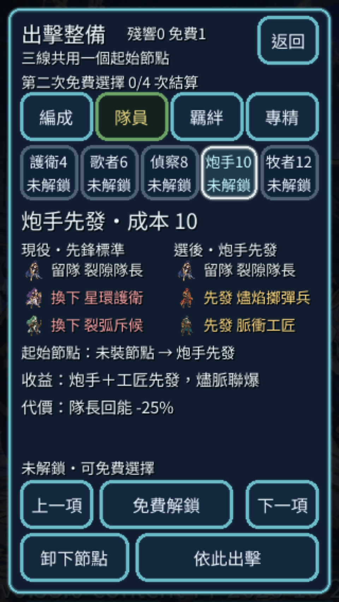

02. 羈絆共用一格：已裝和聲救援，再預覽裂線標記；可看被替換節點與兩套實際三人。正式選單。 [原圖](review-set/02-bond-equipped-versus-preview.png)

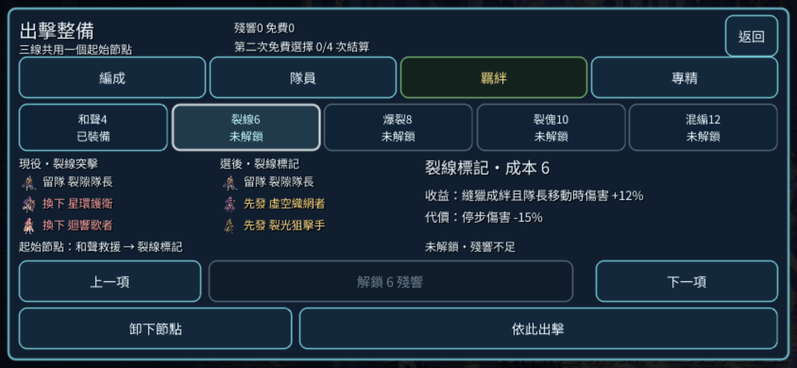

03. 短桌面：專精五項橫向總覽與第五項完整收益、代價、封隙專用說明。正式選單。 [原圖](review-set/03-specialization-short-desktop.png)

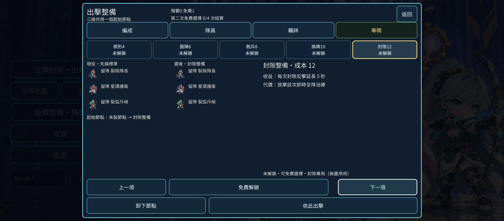

04. 突擊正面實戰：暖金隊長、冰藍隊友、正面石門與盾衛，普通戰報收在角落。連續正常操作。 [原圖](review-set/04-assault-front-active.png)

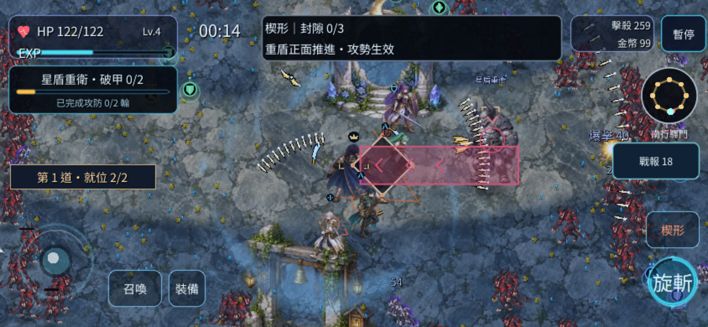

05. 護送正面實戰：圓陣替代與三人站位；相同起始經濟與種子。連續正常操作。 [原圖](review-set/05-escort-front-active.png)

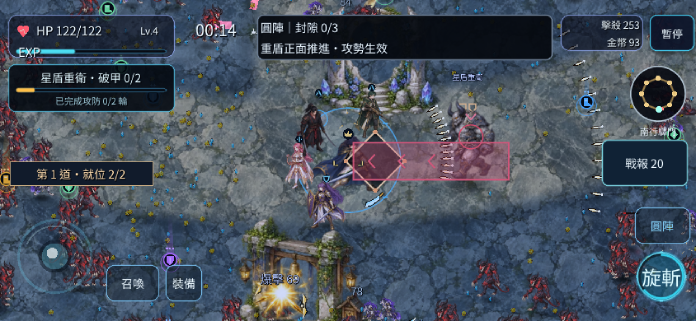

06. 突擊包抄實戰：雙側柱門與兩翼紅區，沒有普通長通知覆蓋戰場。連續正常操作。 [原圖](review-set/06-assault-pincer-active.png)

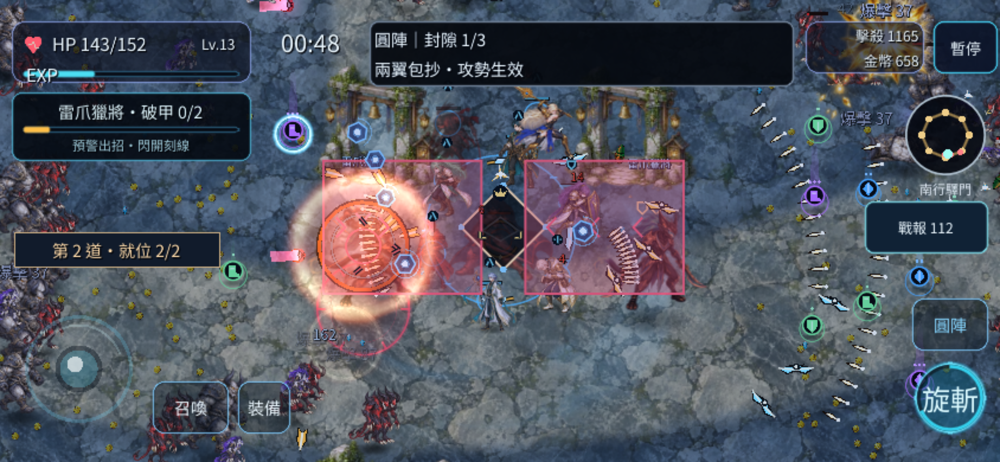

07. 護送包抄實戰：同種子不同站位與支援；正規承傷／保全由原始實跑資料比較。 [原圖](review-set/07-escort-pincer-active.png)

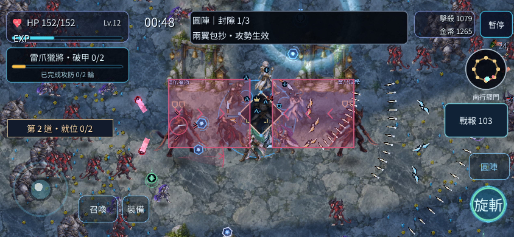

08. 遠射落點：晶塔與祭壇、實際落點圈與敵人，保持原碰撞與預警時序。連續正常操作。 [原圖](review-set/08-assault-artillery-active.png)

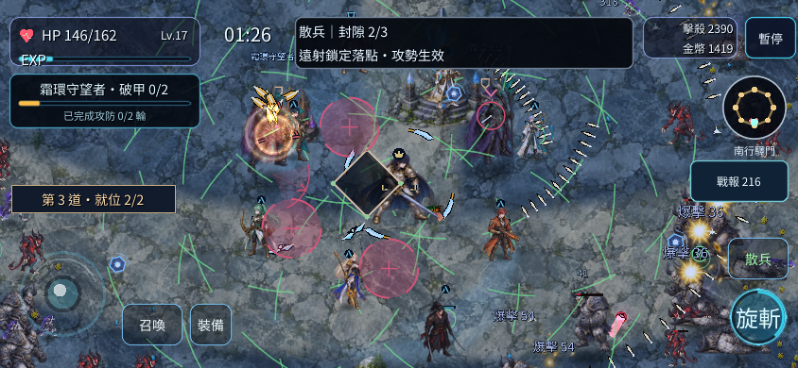

09. 同一護衛起手：真動畫幀與預警；珊瑚色標記辨識實際攻擊來源。連續正常操作。 [原圖](review-set/09-assault-guard-warning.png)

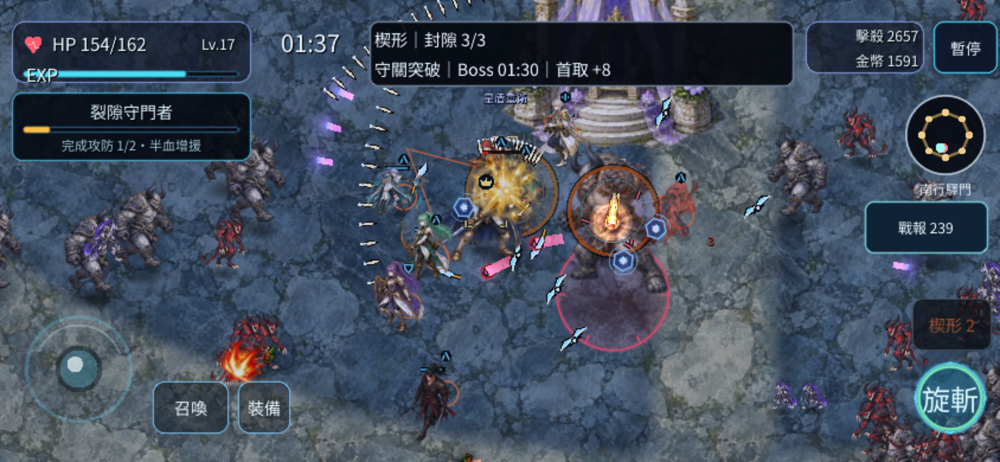

10. 同一護衛命中：實際 attack impact 計數增加，未關閉友方特效或傷害。 [原圖](review-set/10-assault-guard-impact.png)

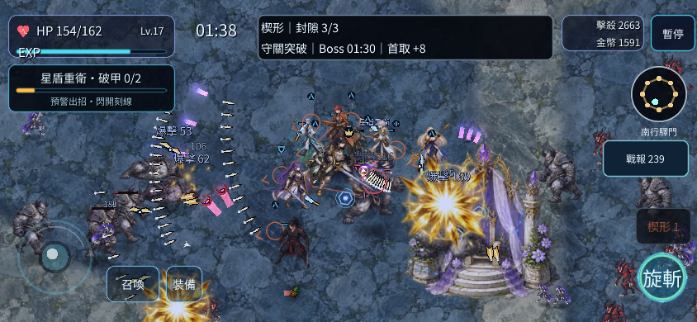

11. 同一護衛收招：實際 recovery 完成，破甲／已完成攻防文字分清進度。 [原圖](review-set/11-assault-guard-recovery.png)

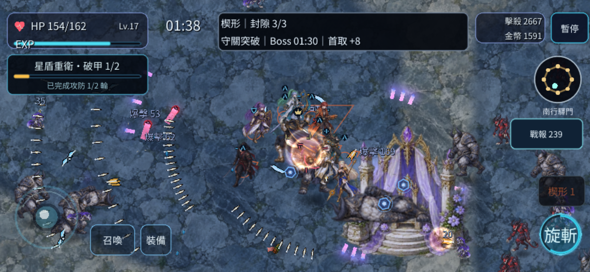

12. 真通關橫向結算：構築、時間、存活、實際節點收益與個人支援分頁。真指標，不用長捲動。 [原圖](review-set/12-assault-victory.png)

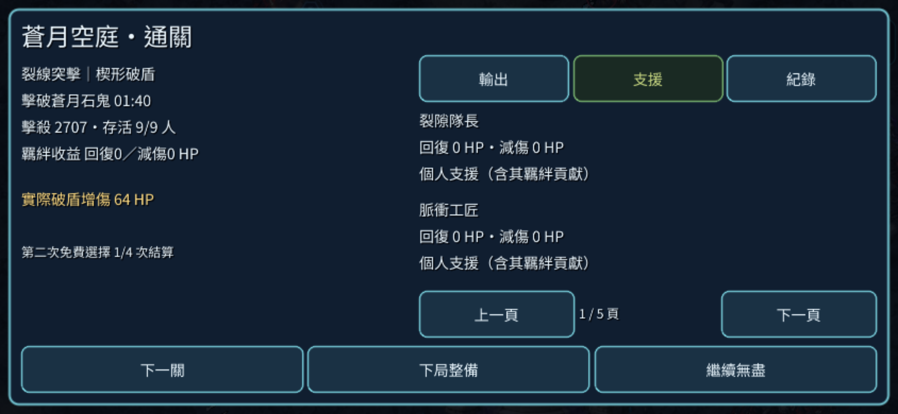

13. 真通關直向結算：完整同一資料的手機排版；角色支援以 HP 單位，羈絆總量另列。 [原圖](review-set/13-escort-victory.png)

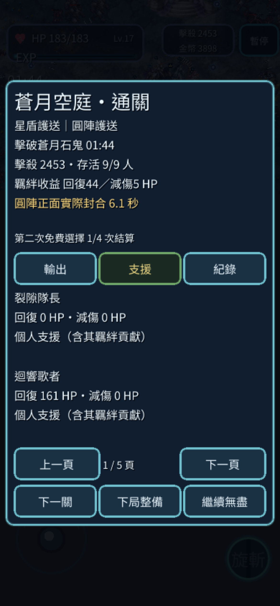

14. 最大字級第四敗：四次真 lethal callback 的受控早敗 fixture；0 秒與巨大減傷來自注入致死傷害，不是自然戰況。 [原圖](review-set/14-fourth-real-defeat-fixture.png)

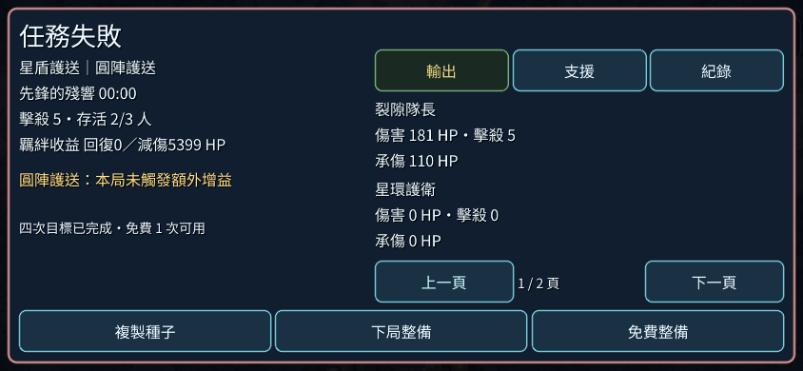

15. 第五局前第二選擇：第四敗後真點主要按鈕進整備，免費一次可用；不是每四局重發。受控前置＋正式入口。 [原圖](review-set/15-fifth-run-free-second-choice.png)

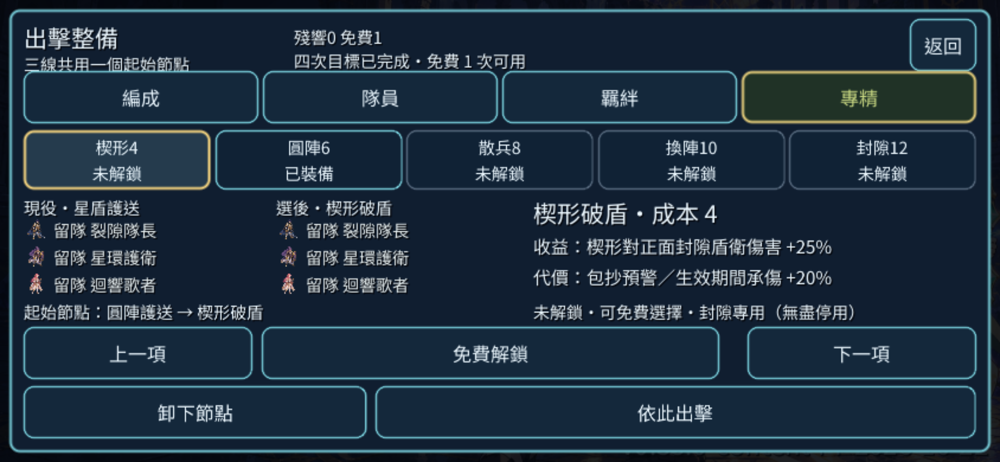
